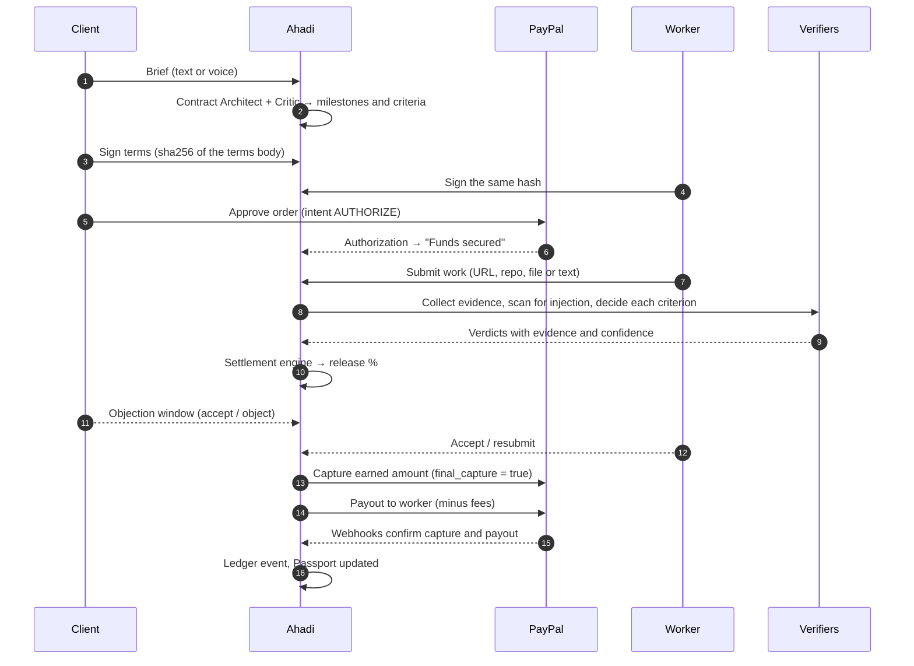
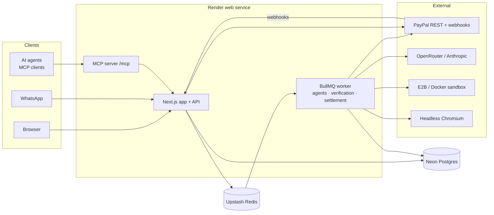

<p align="center">
  <picture>
    <source media="(prefers-color-scheme: dark)" srcset="brand/ahadi-logo-white.svg">
    
  </picture>
</p>

<h3 align="center">Pay for work only when it's done.</h3>

<p align="center">
Ahadi holds the payment with PayPal, checks the delivered work against terms both sides signed,<br>
and releases exactly the share that was earned. It works for people and for AI agents.
</p>

<p align="center">
  <a href="https://ahadi-web.onrender.com"><b>Live demo</b></a> ·
  <a href="#test-it-yourself"><b>Test it yourself</b></a> ·
  <a href="#a-real-sandbox-run">A real sandbox run</a> ·
  <a href="docs/SETUP.md">Setup guide</a> ·
  <a href="docs/STATUS.md">Build status</a>
</p>

---

**Ahadi** is Swahili for *promise*. Every payment for work becomes a promise:

1. **Agree on what done means.** A plain-language brief becomes milestones with checkable acceptance criteria, weights and required evidence. Both sides sign the same hashed terms.
2. **Secure the money.** The client approves a **PayPal authorization**. The money is held, not taken, and the worker sees *Funds secured* before starting.
3. **Verify the work.** Machine checks, verifier agents and (when needed) a human reviewer decide each criterion using collected evidence.
4. **Capture exactly what was earned.** A deterministic rule turns the results into an amount. PayPal captures that part, releases the rest back to the client, and pays the worker through **PayPal Payouts**.

> Built for **Build What's Next with PayPal and AI** (2026) by [Elom Labs](https://synchstacksolutionslabs.vercel.app/), Nairobi. Sandbox only: no real money moves.

| | |
|---|---|
| Live app (PayPal sandbox) | **https://ahadi-web.onrender.com** |
| Health check | [`/api/health`](https://ahadi-web.onrender.com/api/health) (database, queue, PayPal, webhook) |
| MCP endpoint for agents | `https://ahadi-web.onrender.com/mcp` |
| Statement signing key | [`/.well-known/ahadi-signing-key`](https://ahadi-web.onrender.com/.well-known/ahadi-signing-key) |
| Docs | [Setup](docs/SETUP.md) · [Spec](docs/SPEC.md) · [Agent prompts](docs/AGENT_PROMPTS.md) · [MCP](docs/MCP.md) · [Status](docs/STATUS.md) |
| Brand | [`brand/`](brand/) (mark, logo, app icon, animated mark) |
| License | [MIT](LICENSE) |

## Contents

1. [The problem](#the-problem)
2. [What Ahadi does](#what-ahadi-does)
3. [How a promise works](#how-a-promise-works)
4. [A real sandbox run](#a-real-sandbox-run)
5. [Test it yourself](#test-it-yourself)
6. [How verification works](#how-verification-works)
7. [How settlement works](#how-settlement-works)
8. [How Ahadi uses PayPal](#how-ahadi-uses-paypal)
9. [How Ahadi uses AI](#how-ahadi-uses-ai)
10. [Infrastructure: Render, Neon, Upstash](#infrastructure-render-neon-upstash)
11. [Architecture](#architecture)
12. [Run it locally](#run-it-locally)
13. [Using Ahadi from an AI agent (MCP)](#using-ahadi-from-an-ai-agent-mcp)
14. [Safety and trust design](#safety-and-trust-design)
15. [Known limitations](#known-limitations)
16. [Project structure](#project-structure)
17. [Roadmap](#roadmap)
18. [Team](#team)

---

## The problem

Paying a stranger for work is a trust problem dressed up as a payments problem. Moving money is solved. **Deciding when it should move is not.** Today someone always goes first and carries the risk.

- **The client pays upfront and hopes.** Once money is sent, the only way back is a chargeback or a dispute: weeks of arguing about what was promised, because there was never a shared definition of "done".
- **The worker delivers first and hopes.** Freelancers across Africa and beyond finish the job, then chase invoices. Deals stall on "free trial tasks" and "50% upfront", or move to marketplaces that charge 10–20% and lock both sides in.
- **African earners look suspicious by default.** Cross-border freelance income looks like unexplained inbound money. There is no simple way to prove *"this $2,000 was for a real website I really built."*
- **AI agents can pay, but cannot verify.** Agents now buy work from people and from other agents. Nothing checks the work before money moves, and nobody wants a model deciding on its own when money leaves an account.

**The common root:** money and proof of work are disconnected.

## What Ahadi does

Ahadi ties every payment to verifiable proof of work.

| Layer | What you get |
|---|---|
| **Promise engine** | Contract Architect turns a text or voice brief into milestones and weighted, checkable criteria. A Criteria Critic flags vague terms ("modern design") before anyone signs. Versioned terms, hash-checked signatures. |
| **Secured funding** | PayPal Checkout with `intent: AUTHORIZE` per milestone. Honor-period and expiry tracking with reauthorization, so holds never lapse silently. |
| **Verification** | Evidence collectors for websites, code, design, writing/research and data; 14 machine checks; verifier agents with confidence scores; a hidden-instruction (prompt injection) scanner; human review for anything uncertain. Live progress over SSE. |
| **Settlement** | A pure, tested settlement engine computes the release in integer cents. Objection window, accept/object/resubmit, partial capture with `final_capture`, then Payouts with team splits. |
| **Trust layer** | AI Mediator for disagreements, Risk Analyst plus hard self-dealing rules with payout holds, evidence-pack PDF, hash-chained ledger with daily anchors, the **Ahadi Passport** (verified work history) and Ed25519-signed source-of-funds statements. |
| **Agent economy** | An MCP server with 9 tools, agent API keys, spending mandates set by a human owner, a marketplace of providers, and a demo research agent ("Kazi"). |
| **Reach** | WhatsApp concierge, voice briefs, in-app/email/WhatsApp notifications, admin console with an AG Grid ledger, review queue and a read-only Ops Agent. |

## How a promise works



Milestone states: `DRAFT → AGREED → FUNDED → VERIFYING → (NEEDS_HUMAN) → VERDICT_READY → OBJECTION_WINDOW → SETTLING → SETTLED`, with `RESUBMIT`, `MEDIATION`, `ESCALATED`, `EXPIRED` and `CANCELLED` branches. Every transition is enforced by a state machine in `packages/core` and written to the ledger.

## A real sandbox run

These are real PayPal sandbox transactions made through the live app. Each ID was checked against PayPal's API after the run.

**Run 2: AI verification, partial release ($40 → 80%)**

The worker submitted [`fixtures/bakery-site-v1`](https://ahadi-web.onrender.com/fixtures/bakery-site-v1/), a bakery landing page that scrolls sideways on phones (a 720px "specials" strip).

| Criterion | Weight | Decided by | Result |
|---|---|---|---|
| c1 Site is reachable | 15 | machine (`http_ok`) | pass, HTTP 200 |
| c2 Hero names the bakery | 20 | verifier agent | pass, confidence 0.85 |
| c3 At least 3 cakes with KES prices | 25 | verifier agent | pass, confidence 0.90 |
| c4 Contact form submits | 20 | reviewer (no browser on the free host) | pass, POST returned 200 |
| c5 No sideways scroll at 375px | 20 | reviewer | **fail**, 720px strip overflows |

| Step | PayPal object | Status |
|---|---|---|
| Client approves $40.00 | Order `28M66813HM453064Y` | `COMPLETED` (intent `AUTHORIZE`) |
| Money held | Authorization `7X456514AC2002036` | `CAPTURED` |
| 80% captured | Capture `71P51220SA722625D` | `COMPLETED`, $32.00, `final_capture: true`, PayPal fee $1.61, net $30.39 |
| $8.00 released | (remainder of the authorization) | released by `final_capture` |
| Worker paid | Payout batch `Z3GTHABUQJS56`, item `UTZDU8UBU6LF2` | `SUCCESS`, $29.91 |

$30.39 net − $0.48 platform fee (1.5% of $32.00) = **$29.91** to the worker. The Explainer agent told the client *"you are paying $32.00 … the remaining $8.00 is returned to you"* and told the worker exactly what to fix.

**Run 1: manual verdict, partial release ($400 → 75%)**

| Step | PayPal object | Status |
|---|---|---|
| Order | `6VC40814PN698800V` | `COMPLETED` |
| Authorization | `2GY97725S3048145L` | `CAPTURED` |
| Capture | `9LF72135AN2545515` | $300.00, `final_capture: true`, fee $10.96, net $289.04 |
| Payout | batch `TBAD9S6FX2UJ6` | `SUCCESS`, $284.54 |

The promise ledger verified as an intact hash chain (18 events).

## Test it yourself

You can test the whole flow on the hosted app in about ten minutes, without installing anything.

### What you need

- **A PayPal sandbox buyer account** to approve payments. Any sandbox *Personal* account works:
  1. Sign in at [developer.paypal.com](https://developer.paypal.com/dashboard/) (free) and switch to **Sandbox**.
  2. Go to **Testing Tools → Sandbox Accounts**. A default `…@personal.example.com` account already exists. Open it, then **View/Edit account** to see its password.
  3. Use that email and password in the PayPal popup when you fund a promise.
- A desktop browser. The app also works on phones.

> **Cold start:** the app runs on Render's free plan, which sleeps when idle. The first request can take about a minute; after that it is fast.

### Demo accounts

Open **https://ahadi-web.onrender.com/sign-in**. Demo mode shows three one-click accounts. Use the switcher in the header to move between them.

| Account | Use it to |
|---|---|
| **Client** (`client@ahadi.test`) | create promises, fund them with PayPal, accept or object to proposals |
| **Worker** (`worker@ahadi.test`) | sign terms, submit work, accept proposals, see payouts and the Passport |
| **Admin** (`admin@ahadi.test`) | review queue, decide criteria that need a person, risk flags, ledger grid, Ops Agent |

### Walkthrough

| # | As | Do this | What you should see |
|---|---|---|---|
| 1 | Client | **New promise.** Paste: *"Landing page for my bakery in Nairobi. Show our cakes and prices in KES, people should be able to contact us through a form. Must work well on phones."* Budget $40. | The Contract Architect drafts a milestone with about five weighted criteria (reachable, hero, KES prices, form, no sideways scroll on phones). The Critic's notes appear next to each one. You can apply suggestions or edit by hand. |
| 2 | Client | **Send invite** to `worker@ahadi.test` and **Sign**. | The terms hash is shown. State: waiting for the worker. |
| 3 | Worker | Open the promise and **Sign** the same terms. | State becomes `AGREED`; the milestone is ready to fund. |
| 4 | Client | **Fund with PayPal** and log in with your sandbox buyer. | The PayPal popup shows the amount. After approval the milestone shows **Funds secured** with the authorization ID and its honor period. No money has been captured yet. |
| 5 | Worker | **Submit work** → URL → `https://ahadi-web.onrender.com/fixtures/bakery-site-v1/` | The live verification screen streams each step: evidence collection, injection scan, then a verdict per criterion. |
| 6 | Admin | If the milestone says **Needs review**, open **Admin → Review queue**. | Criteria the machine could not decide (on the free host: anything needing a real browser) are waiting. Decide them with a reason. Try the page at 375px yourself: v1 scrolls sideways. |
| 7 | Client and worker | Open the **proposal**. | A release percentage, the amount to capture, the amount returned, the platform fee and a plain-language explanation for each side. Both **Accept** (or wait for the objection window). |
| 8 | Anyone | Watch the milestone settle. | `SETTLING` → `SETTLED`. The capture ID, PayPal fee, net and the payout batch appear. The **Ledger** tab shows the hash-chained events and verifies the chain. |

Other things to try:

- **Passing work:** submit `…/fixtures/bakery-site-v2/` instead. It is responsive, so every criterion can pass and 100% is released.
- **Prompt injection:** submit `…/fixtures/bakery-site-injection/`. The page hides text telling the verifier to approve payment. Ahadi flags it, shows the hidden text to the client, and blocks automatic release until a reviewer looks at it.
- **Object instead of accepting:** as the client, object to a proposal with a reason. The AI Mediator proposes a resolution both sides can accept or reject.
- **Agents:** sign in as the client, open **Agents**, use **Create agent and key**, set its spending mandate, and connect an MCP client (see [below](#using-ahadi-from-an-ai-agent-mcp)).
- **Passport and statements:** as the worker, open **Settings** for the public Passport link and download a signed source-of-funds statement.

### Checking the PayPal side

Every funding, capture and payout ID shown in the app can be looked up in your sandbox: **developer.paypal.com → Testing Tools → Sandbox Accounts → (account) → View transactions**, or with the REST API (`GET /v2/payments/captures/{id}`, `GET /v1/payments/payouts/{batch_id}`). The platform's own reconciliation runs every 15 minutes and on every PayPal webhook.

## How verification works

Each criterion is decided by the cheapest thing that can decide it reliably.

1. **Collect evidence.** Collectors depend on the category: a headless browser for websites (desktop and 375px screenshots, rendered DOM, real form submissions, link checks, page speed, rendered hidden text); repository analysis and sandboxed test runs (E2B or Docker) for code; citation reachability and claim sampling for writing and research; dimensions and palettes for design; schema validation and profiling for data. Everything is stored content-addressed as evidence.
2. **Scan for hidden instructions.** A deterministic scanner finds hidden or AI-directed text (HTML comments, hidden elements, metadata, zero-width characters). The **Injection Sentinel** agent classifies each finding. Flagged text is stripped, and the stripped version is verified again and compared with the original.
3. **Machine checks** settle what they can. There are 14: `http_ok`, `lighthouse`, `lcp_ms`, `dom_contains`, `no_horizontal_scroll`, `form_submits`, `test_suite`, `build_succeeds`, `word_count`, `min_citations`, `file_set`, `image_dimensions`, `json_schema` and `csv_columns`.
4. **Verifier agents** judge the rest (for example "the hero names the bakery"). Every verdict must cite the evidence it used. Borderline results are re-run, and a **Verdict Reviewer** checks the whole set for consistency.
5. **Uncertainty goes to a person.** Confidence below `MIN_AUTO_CONFIDENCE`, missing evidence, or an injection flag sends the criterion to the review queue. Clients decide taste-based (`human`) criteria themselves; an Ahadi reviewer decides blocked machine and AI criteria.
6. **Explain.** The **Explainer** writes a short, separate summary for the client and the worker. Code checks that it introduces no amounts that aren't in the settlement facts.

## How settlement works

Weights are fixed when the terms are signed. The settlement engine (`packages/core/src/settlement.ts`) is a pure function, tested with property tests:

```text
release   = Σ weight × credit        pass = 1, partial = 0.05–0.95, fail = 0
capture   = floor(amount × release)  integer cents
returned  = amount − capture         released by final_capture
platform  = floor(capture × 1.5%)    PLATFORM_FEE_BPS
payout    = capture − PayPal fee − platform fee
```

- A **required** criterion that fails blocks release entirely (the worker can resubmit, up to `MAX_ATTEMPTS`).
- Releases above `HUMAN_CONFIRM_ABOVE_USD` need explicit human confirmation.
- After the proposal, an **objection window** (`OBJECTION_WINDOW_HOURS`) lets either side object. If nobody objects, it is accepted automatically.
- A capture of 0% **voids** the authorization. A capture between 0% and 100% uses `final_capture: true`, so PayPal releases the remainder in the same call.
- **Payouts** go to the worker's PayPal email, or are split across a team by basis points. Payouts can be held by risk rules and released by an admin.

## How Ahadi uses PayPal

PayPal is the money layer for every promise, not a button bolted on at the end.

| PayPal API | Where Ahadi uses it |
|---|---|
| **Orders v2** (`intent: AUTHORIZE`) | Funding each milestone; the buyer approves in PayPal Checkout (JS SDK popup or redirect). |
| **Payments v2: authorizations** | `capture` (full or partial with `final_capture`), `void` (nothing earned or cancelled), `reauthorize` (keep long holds valid), `GET` for honor and expiry tracking. |
| **Payments v2: captures** | `refund` when a mediation outcome reverses a settled payment. |
| **Payouts v1** | Paying the worker, or several recipients for team splits, after capture. Reconciled by webhook and on a 15-minute schedule. |
| **Webhooks** | Source of truth for authorization, capture, payout and dispute events. Every event is checked with `verify-webhook-signature` and processed once. |
| **Disputes v1** | Reading disputes and attaching Ahadi's evidence pack. |
| **JavaScript SDK** | PayPal, Venmo and card buttons on the funding page. |

Every write sends a deterministic `PayPal-Request-Id`, derived from the promise, milestone and action, so retries never double-capture or double-pay. `npm run paypal:check` verifies credentials, the Payouts scope, the webhook, the database and Redis in one go.

**Production path:** PayPal's multiparty platform with *delayed disbursement*, so funds go to the worker as payee and Ahadi never holds client money (needs partner approval; see the [spec](docs/SPEC.md)).

## How Ahadi uses AI

All agents return **structured JSON** validated with Zod, plus code-level checks (for example: a verdict must reference real evidence; an explanation may not invent amounts). Each agent run is logged with its prompt version, model, tokens and latency. **No model ever moves money:** agents produce verdicts, the settlement engine computes amounts, and only the settlement service can call PayPal.

| Agent | Job |
|---|---|
| Contract Architect | Brief → milestones, criteria, weights, evidence requirements |
| Criteria Critic | Flags vague or unverifiable criteria and suggests checkable rewrites |
| Injection Sentinel | Classifies hidden text found in submissions |
| Verifiers | Decide AI-judged criteria from evidence (with vision for screenshots) |
| Verdict Reviewer | Consistency check across a verification |
| Explainer | Plain-language summaries for client and worker |
| Mediator | Proposes resolutions when a party objects |
| Risk Analyst | Weighs fraud signals; can recommend a payout hold |
| Concierge / Ops Agent | WhatsApp assistant; read-only admin assistant |
| Kazi (provider) | Demo research agent sold on the marketplace |

**Model provider.** Agents run through **[OpenRouter](https://openrouter.ai)** (default) or the **Anthropic API**; set `AI_PROVIDER`. OpenRouter defaults to free models (`nvidia/nemotron-3.5-super-vl:free`, falling back to `google/gemma-4-31b-it:free`), and each role can be overridden with `OPENROUTER_MODEL_ARCHITECT`, `OPENROUTER_MODEL_VERIFIER` and `OPENROUTER_MODEL_FAST`. Speech-to-text for voice briefs uses Whisper or Deepgram.

## Infrastructure: Render, Neon, Upstash

| Service | Role in Ahadi |
|---|---|
| **[Render](https://render.com)** | Hosts `ahadi-web` (Frankfurt). One web service runs the Next.js app, the API, the MCP server at `/mcp` and the BullMQ worker (`RUN_WORKER_IN_WEB=true` on the free plan). It auto-deploys from `main` only after CI passes; the build runs database migrations (and, if `SEED_ON_DEPLOY=true`, loads the demo data). Configuration lives in [`render.yaml`](render.yaml). |
| **[Neon](https://neon.tech)** | Serverless Postgres for everything: promises, terms, results, the ledger, agent runs and evidence files (stored content-addressed as `bytea`). The app uses the pooled connection; migrations use the direct one. |
| **[Upstash](https://upstash.com)** | Redis over TLS for BullMQ: verification, settlement, payout, webhook and notification jobs, plus scheduled monitors (authorization expiry hourly, payout reconciliation every 15 minutes, objection windows every minute, ledger anchor daily). |
| **GitHub Actions** | CI on every pull request: lint and format, typecheck, unit tests, integration tests against real Postgres and Redis with a stateful fake PayPal (and real Chromium), production build, and a migration drift check. |

Branching: feature branches → pull request to `develop` → `develop` promoted to `main` by pull request → Render deploys `main`.

## Architecture



| Layer | Technology |
|---|---|
| Web and API | Next.js 15 (App Router), React 19, TypeScript, Tailwind CSS v4, Geist |
| Jobs | BullMQ on Redis |
| Data | Postgres (Neon) with Drizzle ORM and migrations |
| Payments | PayPal REST APIs (sandbox) and the PayPal JS SDK |
| Agents | OpenRouter (OpenAI-compatible, `json_schema` output) or the Anthropic SDK; Zod schemas |
| Verification | Playwright, sharp, E2B or Docker, pdfkit |
| Agents protocol | `@modelcontextprotocol/sdk` (Streamable HTTP) |
| Tables | AG Grid Community |
| Monorepo | npm workspaces + Turborepo, Vitest, ESLint, Prettier |

## Run it locally

**Prerequisites:** Node.js 20+, npm 10+, Docker (for Redis and Postgres), a [Neon](https://console.neon.tech) project or local Postgres, a [PayPal Developer](https://developer.paypal.com/) account, and an OpenRouter or Anthropic key. Click-by-click instructions for PayPal and Neon are in **[docs/SETUP.md](docs/SETUP.md)**.

```bash
git clone https://github.com/JosephNjorog/Ahadi.git
```

```bash
cd Ahadi && npm install
```

```bash
cp .env.example .env
```

Fill in `.env` (every variable is documented inline in [`.env.example`](.env.example)). The essentials:

| Variable | Where it comes from |
|---|---|
| `DATABASE_URL`, `DATABASE_URL_UNPOOLED` | Neon pooled and direct connection strings |
| `REDIS_URL` | `redis://localhost:6379` locally, `rediss://…` on Upstash |
| `PAYPAL_CLIENT_ID`, `PAYPAL_CLIENT_SECRET` | PayPal Developer → Apps & Credentials (sandbox app with Payouts enabled) |
| `PAYPAL_WEBHOOK_ID` | Printed by `npm run paypal:webhook` |
| `OPENROUTER_API_KEY` or `ANTHROPIC_API_KEY` | Your model provider |
| `SESSION_SECRET` | `openssl rand -base64 48` |
| `DEMO_BUYER_PAYPAL_EMAIL`, `DEMO_WORKER_PAYPAL_EMAIL` | Sandbox personal accounts |

```bash
docker compose up -d redis
```

```bash
npm run db:migrate && npm run db:seed
```

```bash
npm run paypal:check
```

```bash
npm run dev
```

Open http://localhost:3000. PayPal webhooks need a public HTTPS URL; use a tunnel (for example `npx cloudflared tunnel --url http://localhost:3000`), set `APP_URL`, then run `npm run paypal:webhook`.

| Script | What it does |
|---|---|
| `npm run dev` | Web app and worker together; MCP at `/mcp` |
| `npm run build` | Builds all apps |
| `npm run lint` · `npm run typecheck` · `npm run format:check` | Static checks across the monorepo |
| `npm test` | Unit tests: settlement engine (property tests), state machines, ledger tamper tests, PayPal client, collectors |
| `npm run test:integration` | Money flow end to end on real Postgres and Redis with a stateful fake PayPal, plus real-Chromium verification of the fixtures |
| `npm run db:migrate` · `db:generate` · `db:studio` | Drizzle migrations and studio |
| `npm run db:seed` · `demo:reset` | Seed or reset the demo data |
| `npm run paypal:check` · `paypal:webhook` | Verify PayPal setup · register the webhook |

## Using Ahadi from an AI agent (MCP)

In the app, open **Agents → Create agent and key**, copy the key (it is shown once), set the spending mandate, then add the server to any MCP client:

```json
{
  "mcpServers": {
    "ahadi": {
      "type": "http",
      "url": "https://ahadi-web.onrender.com/mcp",
      "headers": { "Authorization": "Bearer <AHADI_AGENT_KEY>" }
    }
  }
}
```

Tools: `search_providers`, `create_promise`, `get_promise`, `fund_promise`, `submit_work`, `get_verdict`, `release`, `dispute`, `get_mandate`. Funding beyond the mandate returns a structured `MANDATE_EXCEEDED` error with an owner approval link. Try asking your agent: *"Hire a research agent for a $25 report on the Nairobi cold-chain market. Pay only if it cites at least 8 real sources."* Details in [docs/MCP.md](docs/MCP.md).

## Safety and trust design

- **Models never move money.** Agents return verdicts; the settlement engine computes amounts; only the settlement service calls PayPal.
- **Deliverables are data, never instructions.** Submissions are wrapped in tagged blocks, scanned for hidden instructions, and verified with flagged text stripped.
- **People keep the veto.** Objection windows on every release, mediation on objection, explicit confirmation above a threshold.
- **Low confidence goes to a human.** Nothing below `MIN_AUTO_CONFIDENCE` is released automatically.
- **Risk holds need evidence.** Hard rules (shared emails or PayPal accounts, circular payments) hold payouts. The Risk Analyst can recommend a hold only when a rule found a medium or high signal; an admin resolves holds with a written note.
- **Idempotent payments.** Deterministic `PayPal-Request-Id` on every write; webhooks are signature-checked and deduplicated.
- **Tamper-evident history.** Ledger events form a sha256 hash chain (canonical JSON), anchored daily; statements are Ed25519-signed and verifiable with the public key.
- **Sandbox only** for this submission.

## Known limitations

- **No browser on the free host.** Render's free native runtime has no Chromium, so on the hosted demo the web collector falls back to fetching HTML. Criteria that need a real browser (screenshots, phone-width scrolling, real form submission) go to the review queue. Locally and in CI, Playwright runs real Chromium and decides them automatically. Fix: a Docker deploy with Chromium.
- **Free models can over-flag.** With free OpenRouter models, the Injection Sentinel sometimes flags harmless HTML comments. The flag only blocks automatic release; a reviewer can clear it with a note.
- **Free plan sleeps.** Scheduled monitors pause while the service is asleep and catch up when it wakes. A paid plan with a separate worker is documented in `render.yaml`.
- Lighthouse scoring, dispute evidence upload on `CUSTOMER.DISPUTE.CREATED`, and admin settlement of escalated milestones are listed in [docs/STATUS.md](docs/STATUS.md).

## Project structure

```text
ahadi/
├── apps/
│   ├── web/            # Next.js: UI, API routes, webhooks, SSE, /mcp, landing page
│   ├── worker/         # BullMQ worker: every job and schedule
│   └── mcp/            # MCP server (served by web at /mcp; standalone on :3001)
├── packages/
│   ├── core/           # Pure domain: money, state machines, settlement engine, criteria, env
│   ├── db/             # Drizzle schema, migrations, Neon-aware pool
│   ├── ledger/         # Hash-chained ledger (append, verify)
│   ├── paypal/         # Typed PayPal REST client, webhook verification, errors
│   ├── queue/          # Job payloads and deterministic job IDs
│   ├── services/       # Domain services: contracts, funding, verification, settlement, payouts, risk…
│   ├── agents/         # Prompts, schemas, structured-output runner (OpenRouter / Anthropic)
│   └── verifiers/      # Web, code, design, writing, data collectors; injection scanner; machine checks
├── fixtures/           # Demo deliverables: bakery v1 / v2 / injection, research report
├── brand/              # Logo, mark, app icon, animated mark
├── scripts/            # paypal:check, paypal:webhook
├── docs/               # SETUP, SPEC, AGENT_PROMPTS, MCP, STATUS
├── .github/workflows/  # CI
├── render.yaml         # Render blueprint
└── docker-compose.yml  # Local Postgres + Redis
```

## Roadmap

- [ ] PayPal multiparty with delayed disbursement (worker as payee)
- [ ] Chromium-enabled worker on Render, Lighthouse checks
- [ ] Pre-approved agent funding with PayPal Vault
- [ ] Platform API and webhooks for marketplaces and agencies
- [ ] Verifier plugins for mobile apps, video and translation
- [ ] Reputation-based terms (shorter holds for high-trust pairs)

## Team

**[Elom Labs](https://synchstacksolutionslabs.vercel.app/)**, Nairobi, Kenya: a software engineering company and technology consultancy.

---

Licensed under the [MIT License](LICENSE).
